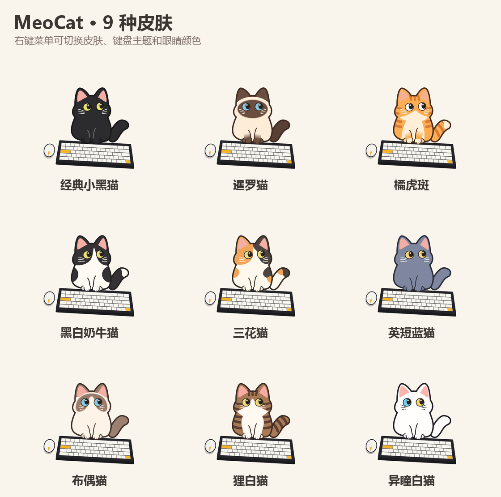
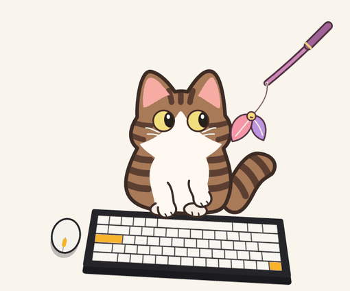

# 🐱 MeoCat — Windows 键盘桌宠

## MeoCat v1.1.0

一只坐在机械键盘上的猫咪桌宠。你在别的窗口打字、点鼠标，它会跟着动；右键猫咪或托盘图标可以换皮肤、换键盘配色、调尺寸。



<p align="center">
  
</p>

## ✨ 功能

- **全局键鼠响应**：Raw Input `RIDEV_INPUTSINK` 硬件扫描码监听，打字和游戏里的按键都能触发动画。
- **输入气泡**：键盘按键、鼠标左键/右键/中键会在桌宠旁浮出提示，默认开启，可在右键菜单关闭。
- **9 种皮肤**：经典小黑猫、暹罗猫、橘虎斑、黑白奶牛猫、三花猫、英短蓝猫、布偶猫、狸白猫、异瞳白猫。皮肤、键盘主题和眼睛颜色的菜单都带缩略图。
- **逗猫棒**：右键选「拿出逗猫棒」，在猫咪附近挥动鼠标，它会追着羽毛抬爪；打字时会先按键。玩完选「收起逗猫棒」。
- **键盘主题 6 款**：奶白暖黄、暗夜极客、复古奶油、草莓猫爪、海盐小鱼骨、暮紫猫耳。
- **2.5D 转头**：猫头、耳朵、眼睛和胡须跟着光标转动，胸口毛色随猫头偏转。
- **眼睛高光**：高光跟随光标滑动，光标停下后仍会缓慢漂移。
- **捕猎状态**：快速晃动鼠标时瞳孔放大、身子压低、尾巴加快摆动。
- **三键彩蛋**：同时按住三个键时，尾巴会伸过去按第三个键，可在菜单关闭。
- **摸猫互动与瞌睡**：摸头会眯眼；约 45 秒无操作开始打瞌睡，约 75 秒闭眼睡着并飘出 Z，按键或移动鼠标唤醒。
- **右键菜单**：圆角面板，带预览图和勾选标记；还有窗口置顶、鼠标穿透、移回右下角。
- **开机启动**：默认关闭；检测到启动项指向旧路径时会显示「开机启动 · 其他路径」，可以改成当前版本或移除旧启动项。
- **最近剪贴板**：默认关闭。记录之后复制的纯文本，可选保留 20 / 50 / 100 条，点一条即可重新复制；图片和文件跳过。
- **尺寸**：5 档缩放，配置保存在本机注册表。

## 📦 下载与运行

前往 **[Releases](../../releases)** 页面下载：

- `MeoCat-Windows-x64.exe` — 单文件，双击运行，常驻右下角托盘。
- `MeoCat-Windows-x64.zip` — 程序与 `LICENSE` 打包。

程序**没有数字签名**，首次运行若出现 SmartScreen 提示，选择「更多信息 → 仍要运行」。

兼容目标为 Windows 7 SP1 x64 及以上，目前只在 Windows 11 上实测。

> 若部分网游以管理员权限运行，右键「以管理员身份运行」`MeoCat.exe` 才能同步捕获游戏内按键。

## 🔨 本地编译

用 MSVC x64 开发者命令提示符，或在 PATH 中放入 MinGW-w64 的 `g++`：

```bat
cd windows
build.bat
```

也可以使用 CMake：

```bat
cd windows
cmake -B build && cmake --build build --config Release
```

## 📁 项目结构

```text
MeoCat/
├── windows/
│   ├── src/
│   │   ├── KeyMap.hpp              # 65% 朝猫键位映射 & 扫描码表
│   │   ├── InputEngine.hpp         # Raw Input 键盘/鼠标监听
│   │   ├── CatPhysics.hpp          # 弹簧物理、转头、捕猎、瞌睡、三键尾巴
│   │   ├── CatRenderer.hpp         # 渲染入口与菜单缩略图
│   │   ├── FlatCatRenderer.hpp     # 平涂贴纸风矢量绘制，9 种皮肤
│   │   ├── ClipboardHistory.hpp    # DPAPI 加密的剪贴板历史
│   │   ├── PopupMenu.hpp           # 圆角菜单与预览图
│   │   ├── Startup.hpp             # 开机启动
│   │   ├── WindowDpi.hpp           # 跨显示器 DPI
│   │   └── main.cpp                # 分层窗口、穿透、托盘、配置
│   ├── app.manifest                # Per-Monitor V2 高分屏适配
│   ├── version.rc                  # 版本信息与图标
│   ├── build.bat
│   └── CMakeLists.txt
├── Sources/                        # 上游 macOS 源码（本项目未构建）
├── Resources/                      # 上游 macOS 资源
├── build.sh                        # 上游 macOS 构建脚本
└── .github/workflows/build.yml     # Windows 自动构建
```

## 🔒 隐私

键盘与鼠标信号只在本地内存里驱动动画和计数，不记录按键内容、不写日志、不联网。

「最近剪贴板」默认关闭，开启后只保存纯文本，并用 Windows DPAPI 以当前账户加密存放在 `%LOCALAPPDATA%\KaraCat\clipboard.dat`（为兼容旧版保留这个路径）。「清空 MeoCat 历史」会删除这个存档。

## 📄 License

[MIT License](LICENSE)。
